<!-- ===================== CABEÇALHO ===================== -->

  

  
  
  

 

<!-- ===================== SOBRE MIM ===================== -->
## Sobre Mim

Olá! 👋 Sou o **João Teixeira**, tenho 20 anos e sou estudante de **Engenharia de Computação** no Instituto Politécnico da UERJ (**UERJ-IPRJ**). Atualmente faço parte do setor de **Propulsão** da **Equipe Serra Rocketry**.

Trabalho na interseção entre o mundo físico e o digital, unindo **design de hardware** e **lógica de programação**. Tenho facilidade em transformar ideias em realidade — da prototipagem de peças físicas à programação de componentes eletrônicos.

- 🎓 **Formação:** Engenharia de Computação — UERJ-IPRJ
- 🚀 **Atualmente:** Setor de Propulsão — Equipe Serra Rocketry
- 💡 **Interesses:** Sistemas embarcados · Modelagem 3D (CAD) · Arquitetura de banco de dados

 

<!-- ===================== STACK ===================== -->
## Habilidades e Ferramentas

| Área | Tecnologias |
| :--- | :--- |
| **Linguagens** |    |
| **Banco de Dados** |  |
| **Modelagem 3D (CAD)** |   |
| **Sistemas Embarcados** |  |
| **Versionamento** |  |

 

<!-- ===================== ESTATÍSTICAS ===================== -->
## Estatísticas e Commits

  

 

  <picture>
    <source media="(prefers-color-scheme: dark)" srcset="https://raw.githubusercontent.com/diasstilben/diasstilben/output/pacman-contribution-graph-dark.svg">
    <source media="(prefers-color-scheme: light)" srcset="https://raw.githubusercontent.com/diasstilben/diasstilben/output/pacman-contribution-graph.svg">
    
  </picture>

 

<!-- ===================== CONTATO ===================== -->
## Contato

Entre em contato pelos canais abaixo:

  
  
  

<!-- ===================== RODAPÉ ===================== -->

  

